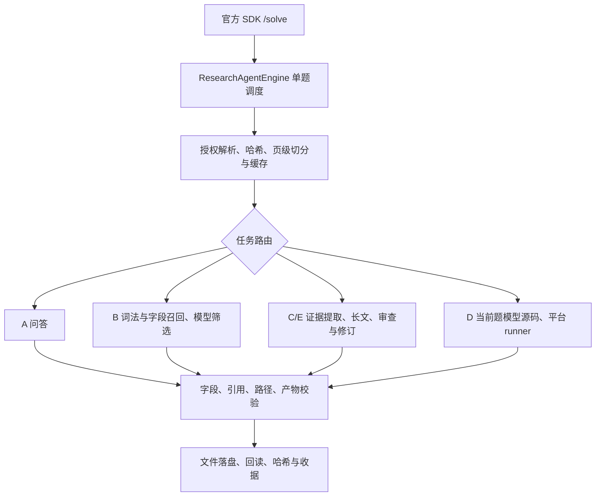

# 科研助手 Agent 架构审查与升级建议

审查日期：2026-10-22。对象：当前 0.3.1 源码、最近三轮运行记录、最终定向复测和最新官方 source-v1 材料。

## 1. 总体判断

当前系统是 Python 实现的单调度器科研工作流，已具备 A/B/C/D/E 路由、授权材料解析、本地检索、事实台账、报告审查、实验接口和结果回读。材料授权、文件哈希、严格输出字段、失败指标置空、JSON/Markdown 一致性等基础值得保留。

升级重点应是：准确记账和提前分配预算、按问题补齐证据、声明与原文逐条绑定、D 类模型代码的自测修复闭环，以及与正式容器一致的验证。建议继续采用显式、可追踪的执行流程；增加多个自主 Agent 的复杂度，目前缺少相应收益证据。

### 当前结构



当前 `HybridRetriever` 是词法匹配、字段覆盖和查询改写的组合，没有向量检索。目录分层已经存在，但 `workflows/tasks.py` 同时承担检索筛选、事实提取、写作、审查、修订和保底输出，职责仍偏多。

## 2. 运行证据说明了什么

最近三轮使用统一评审口径后的本地代理分：

| 轮次 | 总分 | C 类 /25 | E 类 /15 | 长文保底次数 |
|---|---:|---:|---:|---:|
| 第一轮 | 93.9919 | 22.00 | 15.00 | 0 |
| 第二轮 | 90.7407 | 24.25 | 8.25 | 1 |
| 第三轮 | 91.6931 | 22.00 | 12.00 | 2 |

- 33/33 题完成文件预检查，说明工程提交链路能够运行；内容质量没有呈现稳定上升。
- 后两轮的三次长文保底均记录了预算不足。C/E 单题记录用量大多为约 2.7 万至 3.4 万 Token。
- 最终代码的 B-01、C-03、E-01 定向复测改善了对应案例，但 C/E 均首稿通过，未在真实调用中走到最新的局部修订分支。
- 这三轮使用同一批七篇论文构成的冻结题材；它们验证版本回归，不能独立证明未知学科泛化能力。
- C/E 生成与评分使用同一模型。D 使用旧公开离线 runner，三轮 D 的模型调用记录为零，未覆盖正式要求的当前题 Gateway 源码生成与来源凭证完整链路。
- 三轮成绩属于本地诊断分。第一轮原始分与统一口径重评值均保留，本文使用后者。

数据：`output/v3-optimization-20261022/summary.json`、`docs/2026-10-22-三轮仿真与逐轮优化.md`。

## 3. 本次实际复现的四个问题

采用进程内假响应和合成片段进行离线探针；下列是实现行为的复现，不是新的论文模型评测分。

### 3.1 失败响应漏记 Token：优先修复

位置：`src/research_agent/integrations/llm.py:89`，标准库后备分支 `:238`。

当前先检查完成状态、解析 JSON，再累加 `total_tokens`。因此已经返回 usage 的截断响应、非法 JSON 响应没有被记入本地预算。

探针结果：

- 截断响应提供 `usage.total_tokens=123`，实际发起一次请求，本地累计为 0。
- 两次非法 JSON 响应各提供 123 Token，实际发起两次请求，本地累计仍为 0。

影响：后续重试可能超过配置预算；现有统计在遇到这些失败时会低估消耗。无法仅凭现有成功响应记录反推历史遗漏量。

建议：收到响应即记录 usage 和完成状态，再解析业务内容；每次重试重新计算剩余额度。无 usage 的失败标记为消耗未知，并采用保守额度预留，不将估算伪装成实测。

### 3.2 查询数量约定不一致

位置：`integrations/llm.py:43`、`rag/retrieval.py:42`。

提示词允许最多八个子问题，但 `QueryPlan.from_model` 截断为五个。探针输入八项，结果只剩五项。后面三个目标失去独立子查询召回通道，原问题通道仍可能召回它们，但覆盖没有保证。

建议：查询 Schema、提示词和执行限制共用配置；增加目标覆盖检查，显式记录哪些目标没有候选。

### 3.3 参考文献后的附录被当成参考文献

位置：`rag/materials.py:176`、`:186`；`rag/retrieval.py:48`。

`reference_section` 在识别 References 后置为 True，后续没有在 Appendix 等章节退出。检索器又会排除所有 references 片段。

探针构造 References 后接 Appendix A：附录标题和实验正文均被标为 references，可检索附录片段数为 0。

建议：采用章节状态识别，支持附录和补充材料重新进入正文；参考文献尽可能按条目块识别。增加“正文→参考文献→附录→表格”的结构回归样例。

### 3.4 排除理由的否定语义误判

位置：`workflows/tasks.py:443`。

探针理由 `This paper is not explicitly excluded and is relevant.` 被判定为应排除，因为正则直接匹配 `explicitly excluded`。

此外，`:148` 的强命中规则可以重新加入未获模型批准的论文，没有保留“明确拒绝”与“遗漏/格式失败”的状态区别。

建议：内部模型结果使用 `include/exclude/uncertain`、对应条件和证据编号；自然语言理由用于展示。强词法命中可触发复核，不应覆盖明确拒绝结论。最终外部 JSON 字段继续严格遵守赛事 Schema。

## 4. 架构升级优先级

### P0：统一每题预算、时限和取消信号

当前引擎、模型客户端和实验子进程各自管理时限。引擎主要在提交前检查取消，D 子进程在源码生成后仍可以获得固定 175 秒，不能保证两段时间相加落在单题期限内。等待全局锁的时间也不包含在 `_solve_one` 创建的期限内。

建议新增 `CaseSession`，统一保存：

- 接收时间、绝对截止时间、取消信号；
- 真实模型调用数、已知 Token、未知消耗和预留额度；
- 当前阶段、授权材料、证据集合、运行目录；
- 题目、材料、源码和提示词版本摘要。

解析、模型请求、重试、样例自测、平台执行共用剩余时间。耗时阶段设置检查点，取消后及时停止后续模型请求和可终止的子进程。保留适合当前资源条件的串行执行，并把排队状态显式化。

长文开始提取前，先预留写作、一次审查、一次修订及最终检查的估算额度；超预算时减少重复证据和非关键内容。不能等到报告写完才发现无法审查。

### P0：补齐 D 类模型源码自测与修复闭环

当前 `LayeredDRunner.prepare_generated_implementation` 生成一次完整源码，完成语法和入口检查后直接交给平台 runner；没有公开样例执行、结果结构核对和模型修复循环。

建议流程：

1. 解析当前题 `method.md`、`protocol.json`、`sample.json`，形成接口约束。
2. 在本题 Gateway 会话生成完整源码，保存完整回复和源码摘要。
3. 在隔离执行环境运行公开样例，检查字段、类型、维度、有限数值和公开要求中的边界条件。
4. 失败时把必要诊断反馈给同一会话模型，要求重新输出完整源码；次数由时间和 Token 预算限定。
5. 将最终模型源码原样交给当前平台客户端，保存来源、执行回执及产物。

官方 source-v1 README 第 18 行明确允许公开样例自测及让模型重新返回完整修复源码。Agent 本地不能拼接补丁或自行修改算法后提交。正式来源凭证仍只能在官方活动会话验证。

D 类占总分 40%，这条路径应优先获得真实集成证据。把“本地算法正确”“模型生成可运行”“来源协议通过”“官方受控实验得分”分别记录。

### P1：从事实列表升级为问题覆盖与声明绑定

现在 quote 原文匹配、引用页码检查和模型审查已经存在。但原文摘录能定位，只能证明来源存在；仍需检查 claim 是否忠实解释原文。当前页码验证也没有逐句绑定每个正文事实。

建议增加：

- **要求—证据矩阵**：逐项列出研究问题、方法、数据、基线、指标、结果、限制和跨论文比较条件；缺哪项，只补检哪项。
- **结构化声明**：事实文本、来源摘录、文件页码、原论文贡献或相关工作、适用范围、证据编号、支持状态。
- **数字与实验条件绑定**：数值、单位、数据集、划分、指标口径和比较对象共同保存，避免不同实验数值被直接横向比较。
- **正文绑定**：每个事实段对应声明编号；题目模拟观察和拟议方案单独标记来源类别。

先消除不被原文支持的声明，再写作。内部模型输出逐阶段做结构验证，避免格式异常直接变成整题异常。

### P1：RAG 增加按需深入和结构保真

当前 B 类通常只解析每篇前八页，`materials` 条目数达到 250 时改为四页；当前检索没有对候选论文进一步全文补读。深层实验细节、附录限制和补充结果可能遗漏。

建议采用两级检索：

1. 文件名、标题、摘要和首页轻量候选索引。
2. 对高相关候选及尚未覆盖的条件读取全文，检索方法、实验、表格和附录。

按解析后实际文件数和数据规模控制预算，避免授权目录只占一个 materials 条目时误判库大小。缓存倒排索引和词项统计，减少每题重新分词及每个查询全片段扫描。

切分继续保留物理页码、哈希和偏移，增加父段落、章节、表格标题/表头/单位/脚注关系。小片段用于召回，抽取事实时补齐相邻语境，尤其是条件和否定句。

可把轻量本地向量召回作为后续受控实验：先测跨语言和同义表达的实际漏召，再比较 Recall@k、误召、冷启动和内存。是否采用由正式资源预算内的实测收益决定。

### P1：C/E 分别规划，修订后检查全篇覆盖

Survey 与 Idea 当前共用长文流程与大部分提示词，但二者交付重点不同：

- C：围绕题目比较维度组织论文证据矩阵，说明差异、适用条件和不可比之处。避免逐篇事实列表占用过多正文预算。
- E：先生成结构化研究设计，包括假设、输入输出、文献互补、基线、数据、实验、消融、指标、预算、失败边界和证伪标准，再渲染正文。

局部修订可继续保留，节省重复生成成本。修订后对变更做语义复核，同时检查全篇问题覆盖、前后矛盾、引用映射和是否删除了唯一支持某项要求的段落。

保底输出应记录缺失维度，优先保留题目最关键、有依据的内容。内部区分“文件结构通过”和“内容审查通过”，避免把保底成功落盘当成质量成功。

### P1：建立真正独立的评测与发布门槛

建议把评测拆成：

- 工程契约：输入边界、JSON、路径、授权、指标和文件一致性。
- 内容质量：B 的准确率/召回率；C 的事实覆盖、归因与数值支持；E 的可执行性、互补关系与证伪设计。
- 运行资源：冷/热缓存、总耗时、阶段耗时、峰值内存、Token、重试与保底率。
- 正式协议：官方 SDK、当前源码来源流程、容器挂载、当前客户端与回执。

开发题与留出题按论文和领域隔离。固定裁判、题目、源码版本后再测；开发集可以反复优化，留出集不在同一轮看答案后继续调分。语义评分有条件时由独立模型或盲审抽样校准，最终仍以官方评测为准。

增加边界题：中英文混排、中文论文、参考文献后的附录、多栏表格、少量扫描页、实验条件不一致、同名方法、否定/双重否定、无相关论文及授权材料缺失。

最终 0.3.1 还需在正式基础镜像和约定资源限制下完整重跑，校验源码摘要、镜像标签、tar 摘要与报告一致。当前共享目录中的 0.3.0 tar 不包含本轮 0.3.1 代码。

### P2：按职责拆分代码与配置

建议渐进拆分，沿用现有 Python 工程，不同时引入大型编排框架或多个服务：

```text
src/research_agent/
  core/                 # CaseSession、预算、调度和配置
  rag/                  # 文档结构、索引、候选召回、证据补检
  evidence/             # 声明、来源类别、覆盖矩阵、语义核验
  workflows/            # chat、retrieval、survey、idea、reproduction
  integrations/         # 模型网关、官方运行接口
  contracts/            # 官方输出 Schema 和文件验证
prompts/                # 分阶段、可追踪版本的提示词
configs/                # 开发、公开仿真、正式配置模板，不含凭据
evaluation/             # 数据集定义、冻结评分、留出题和分析
tests/                  # 单元、协议、故障与容器集成测试
docs/                   # 架构、决策、验证和发布记录
scripts/                # 构建、预检查、仿真及打包
```

新增资源目录要同步加入 Docker 构建白名单。网关 SDK 与标准库后备通道的系统约束、模型参数、预算记账和错误分类应共用逻辑，防止切换后行为不一致。依赖继续固定版本，并记录构建环境和实际安装清单。

## 5. 建议执行顺序与验收

| 顺序 | 工作 | 可检查的验收结果 |
|---|---|---|
| 1 | 修复四个已复现问题 | 失败响应被计费；八目标完整保留；附录进入检索；否定理由不误排 |
| 2 | 统一 CaseSession 与预算 | 取消/截止后不再启动新阶段；每次重试消耗可追踪；完整预留写作和修订预算 |
| 3 | D 自测和模型修复 | 当前题真实模型代码完成公开样例；故障能触发完整源码重新生成；正式凭证另行验证 |
| 4 | 覆盖矩阵、声明绑定、两级检索 | 留出题漏召减少；事实和数字可回查；证据不足有明确记录 |
| 5 | C/E 独立规划与审查 | 内容覆盖改善、保底率下降，同时满足资源上限；结果以实际测试报告为准 |
| 6 | 容器全链路与发布 | 最终源码完整仿真、镜像构建、接口测试、tar 摘要和交付说明一致 |

每个阶段保留原始失败记录和独立复测结果。当前证据不支持承诺某个升级后分数，优先追踪稳定性、错误类型和未知题上的表现。
